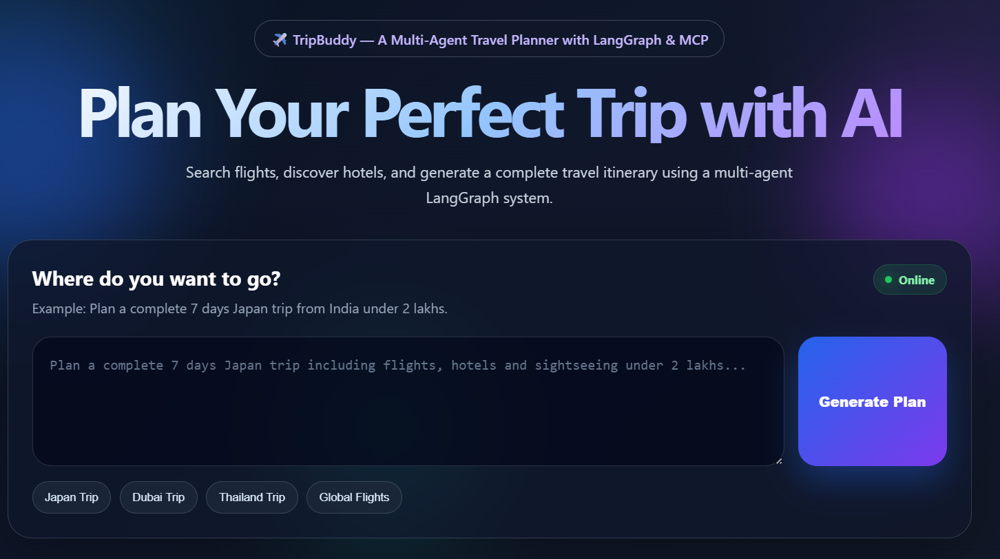
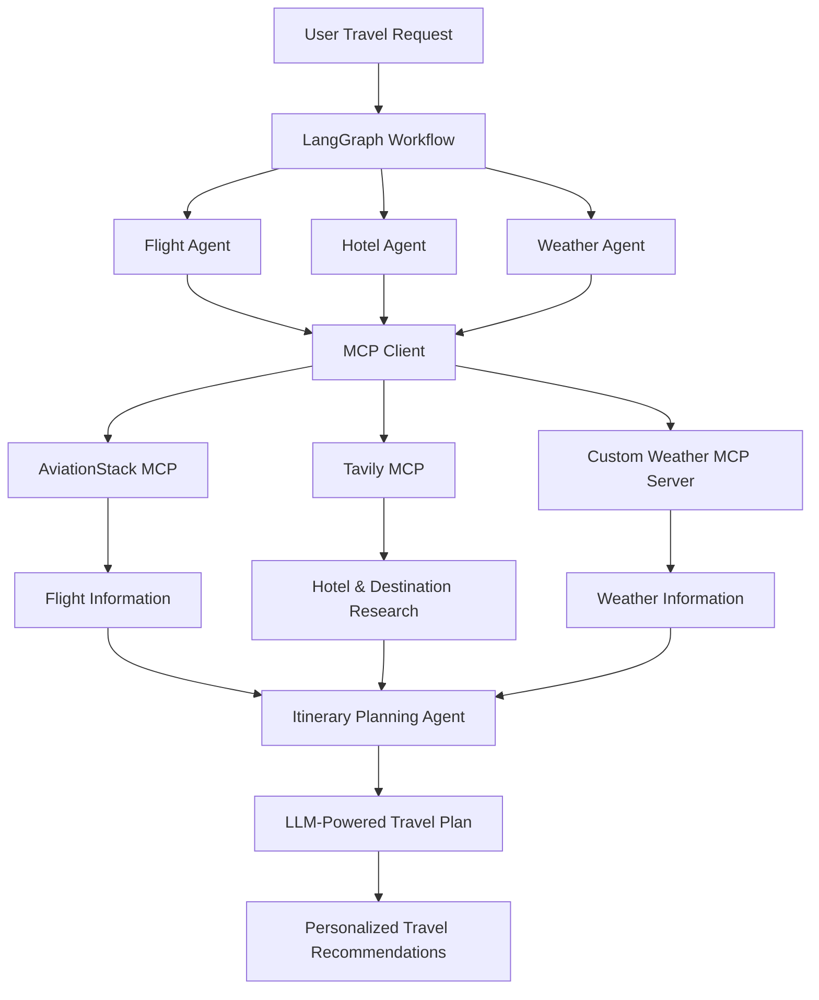

# ✈️ TripBuddy – AI-Powered Multi-Agent Travel Planner

### Intelligent Travel Planning with LangGraph, MCP, Groq LLM & Real-Time APIs

<p align="center">
  <a href="https://tripbuddy-multi-agent-trip-planner-with.onrender.com/">
    
  </a>
  
  
  
  
</p>

**TripBuddy** is an AI-powered travel planning application built using **LangGraph, LangChain, and Large Language Models (LLMs)**. It leverages a multi-agent architecture to simplify travel planning by coordinating specialized AI agents responsible for flight discovery, hotel research, weather analysis, and itinerary generation.

The system integrates external services through the **Model Context Protocol (MCP)**, enabling AI agents to access real-world information through a standardized tool-integration layer.

By combining agent orchestration, external API integrations, and intelligent workflow management, TripBuddy transforms natural-language travel requests into comprehensive and personalized travel plans.

## 🌐 Live Application

<p align="center">
  <a href="https://tripbuddy-multi-agent-trip-planner-with.onrender.com/">
    
  </a>
</p>

**Live Demo:** https://tripbuddy-multi-agent-trip-planner-with.onrender.com/

## 📸 Application Preview

<p align="center">
  
</p>

*TripBuddy provides an interactive interface where users can submit travel requirements and receive AI-powered travel recommendations.*

---

## 🌟 Key Features

- **Multi-Agent Architecture:** Uses specialized AI agents to divide complex travel-planning tasks into smaller, manageable responsibilities.
- **LangGraph Orchestration:** Coordinates agent execution through graph-based workflows and shared state management.
- **LLM-Powered Reasoning:** Integrates Groq LLMs for intelligent decision-making, information processing, and travel recommendations.
- **MCP-Based Tool Integration:** Connects AI agents with external services through the Model Context Protocol.
- **Flight Discovery:** Integrates AviationStack to retrieve flight-related information.
- **Hotel Research:** Uses Tavily to search for accommodation options and destination-related information.
- **Weather Intelligence:** Integrates OpenWeather through a custom MCP server to retrieve current weather conditions and forecasts.
- **Personalized Itinerary Generation:** Combines information gathered by specialized agents to create structured travel plans.
- **Modular Architecture:** Separates agent logic, tool integrations, and workflow orchestration for easier maintenance and extensibility.

---

## 🏗️ System Architecture

TripBuddy follows a collaborative multi-agent architecture powered by LangGraph. Each agent focuses on a specific travel-planning task, while LangGraph manages workflow execution and information exchange.

### High-Level Architecture



### Workflow Explanation

1. **User Input:** The user provides travel requirements, including destination, travel dates, and preferences.
2. **Workflow Initialization:** LangGraph initializes the travel-planning workflow and manages the shared state.
3. **Specialized Agent Execution:** Flight, hotel, and weather agents handle their respective responsibilities.
4. **MCP Integration:** Agents access external tools through the MCP client.
5. **Information Retrieval:** External services provide flight information, accommodation research, and weather forecasts.
6. **Itinerary Generation:** The itinerary agent combines the retrieved information and generates a personalized travel plan.
7. **Final Output:** The system provides the user with structured travel recommendations.

---

## 🤖 Specialized AI Agents

| Agent | Responsibility |
|---|---|
| **Flight Agent** | Retrieves flight-related information using AviationStack through MCP integration. |
| **Hotel Agent** | Researches accommodation options and destination information using Tavily. |
| **Weather Agent** | Retrieves current weather conditions and forecasts through the custom OpenWeather MCP server. |
| **Itinerary Agent** | Combines information from different agents to generate a comprehensive travel itinerary. |

---

## 🔌 Model Context Protocol (MCP) Integration

A major component of TripBuddy is its integration with the **Model Context Protocol (MCP)**, which provides a standardized way for AI agents to interact with external tools and services.

The application uses `MultiServerMCPClient` to manage multiple MCP server connections.

| MCP Integration | Transport | Purpose |
|---|---|---|
| Tavily MCP | Streamable HTTP | Web search and destination research |
| AviationStack MCP | STDIO | Flight-related information |
| Custom Weather MCP | STDIO | Current weather and weather forecasts |

### Custom Weather MCP Server

The project includes a custom weather MCP server developed using **FastMCP**.

It exposes weather-related tools such as:

- `get_current_weather(city)` – Retrieves current weather information for a specified city.
- `get_forecast(city)` – Retrieves upcoming weather forecasts using the OpenWeather API.

This integration allows AI agents to access weather information through MCP rather than directly coupling agent logic with the external weather API.

---

## 🛠️ Technology Stack

| Category | Technologies |
|---|---|
| Programming Language | Python |
| Agent Orchestration | LangGraph |
| LLM Framework | LangChain |
| LLM Provider | Groq |
| Language Model | `openai/gpt-oss-120b` |
| Tool Integration | Model Context Protocol (MCP) |
| MCP Client | MultiServerMCPClient |
| MCP Server Framework | FastMCP |
| Flight Information | AviationStack |
| Web Search | Tavily |
| Weather Services | OpenWeather |
| Environment Configuration | Python dotenv |

---

## ⚙️ Installation & Setup

### 1. Clone the Repository

```bash
git clone https://github.com/harshmotiramani2002/TripBuddy-Multi-Agent-Trip-Planner-with-LangGraph.git

cd TripBuddy-Multi-Agent-Trip-Planner-with-LangGraph
```

### 2. Create a Virtual Environment

```bash
python -m venv venv
```

Activate the environment:

**Windows:**
```bash
venv\Scripts\activate
```

**Linux / macOS:**
```bash
source venv/bin/activate
```

### 3. Install Dependencies

```bash
pip install -r requirements.txt
```

### 4. Configure Environment Variables

Create a `.env` file in the project root directory and add the required API credentials.

```env
GROQ_API_KEY=your_groq_api_key
TAVILY_API_KEY=your_tavily_api_key
AVIATIONSTACK_API_KEY=your_aviationstack_api_key
OPENWEATHER_API_KEY=your_openweather_api_key
```

**Note:** Use the exact environment variable names referenced in the project code. Never commit your `.env` file or expose API credentials publicly.

### 5. Run the Application

Start the application using the entry-point script configured in the repository.

---

## 🚀 Deployment

The application integrates its backend and MCP services and is deployed as a cloud-hosted application.

The deployment setup includes:

- Cloud-based application hosting using Render.
- Environment-based configuration for API credentials.
- External API integrations for travel-related information.
- LangGraph-based multi-agent workflow execution.

**Live Application:** [Launch TripBuddy AI](https://tripbuddy-multi-agent-trip-planner-with.onrender.com/)

---

## 🧠 Key Engineering Concepts Implemented

- **Multi-Agent Systems:** Breaking complex tasks into specialized agent responsibilities.
- **Graph-Based Workflow Orchestration:** Managing agent execution and transitions using LangGraph.
- **LLM Integration:** Leveraging Groq-powered language models for intelligent reasoning.
- **MCP Architecture:** Connecting AI agents with external tools through a standardized protocol.
- **API Integrations:** Retrieving external information from flight, search, and weather services.
- **Modular Development:** Separating agent responsibilities and tool integrations for maintainability.
- **State Management:** Managing information exchanged across different stages of the travel-planning workflow.

---

## 🔮 Future Enhancements

- Integration with additional flight and hotel booking platforms.
- More advanced budget estimation and optimization.
- Improved itinerary personalization based on user preferences.
- Additional specialized agents for sightseeing and local recommendations.
- Enhanced error handling and recovery mechanisms.
- Persistent conversation memory and improved workflow management.

---

## 👨‍💻 Author

**Harsh Motiramani**

Electrical Engineering Undergraduate | IIT (BHU), Varanasi

Interested in Software Development, Artificial Intelligence, Agentic AI, and Backend Engineering.

- **GitHub:** [harshmotiramani2002](https://github.com/harshmotiramani2002)
- **LinkedIn:** [Harsh Motiramani](https://linkedin.com/in/harsh-motiramani-1877232a8/)

---

<p align="center">
  <b>Built with ❤️ and dedication by Harsh Motiramani</b>
  <br/>
  ⭐ If you find this project interesting, consider giving the repository a star!
</p>
